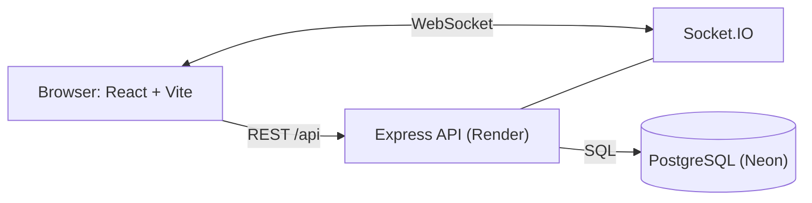

# DevSync

> Real-time task management for developer teams: Kanban boards, roles, comments, notifications and live presence.

**Live demo:** https://devsync-sooty.vercel.app
**API health check:** https://devsync-api-jt06.onrender.com/api/health

> The backend runs on a free instance that sleeps when idle, so the first request can take up to a minute. After that it responds normally.

## Screenshots

**Kanban board** with drag and drop, live presence and notifications


**Task details** with assignee, due date and comments


**Team page** with projects, members, roles and invitations


**Teams dashboard**


**Login**


## Features

- **Authentication:** register and login with bcrypt-hashed passwords, 15-minute JWT access tokens, and rotating refresh tokens that are stored only as hashes.
- **Teams and roles:** owner, admin and member roles, with invitations through one-time tokens.
- **Projects and tasks:** priority, due date, assignee, filters and pagination. Archived projects are read-only.
- **Kanban board:** drag and drop between and within columns. The server keeps card positions consistent inside a database transaction.
- **Comments and an activity log** for every project.
- **Live updates with Socket.IO:** task and comment changes appear instantly for everyone on the board, along with a "who is online" list.
- **Notifications:** saved in the database and pushed live to the right person when they are assigned a task or someone comments on their task.

## Architecture



## Tech stack

| Layer | Choice |
|---|---|
| Frontend | React, Vite, Tailwind CSS, React Router, dnd-kit |
| Backend | Node.js, Express 5 |
| Real time | Socket.IO |
| Database | PostgreSQL (Neon) with plain parameterised SQL |
| Validation | Zod |
| Auth | JWT, bcryptjs, refresh token rotation |
| Hosting | Vercel (frontend), Render (backend), Neon (database) |

## Design decisions

- **Refresh token rotation:** every refresh revokes the old token. Only SHA-256 hashes are stored, so a leaked database cannot be used to log in.
- **Permissions in middleware:** role checks run before the controllers. A person outside a team gets a 404 instead of a 403, so team ids cannot be probed.
- **Consistent card order:** moving a card closes the gap in the old column and opens one in the new column inside a single transaction, so positions always stay 0, 1, 2...
- **Socket security:** the JWT is checked when the socket connects. Joining a project room repeats the same team-membership check as the REST API, and notifications go to a private room per user.
- **No SQL injection:** all values are parameters. The one dynamic query (task updates) takes its column names from a fixed map, never from user input.
- **Dates as plain strings:** `DATE` columns are returned as `YYYY-MM-DD`, which avoids timezone shifts.
- **Notifications never break a request:** a failure while notifying is logged and ignored.

## API overview

| Area | Endpoints |
|---|---|
| Auth | `POST /api/auth/register`, `login`, `refresh`, `logout`, `GET /api/auth/me` |
| Teams | `POST/GET /api/teams`, `GET /api/teams/:id`, `POST /api/teams/:id/invitations`, `PATCH/DELETE /api/teams/:id/members/:userId` |
| Invitations | `POST /api/invitations/accept` |
| Projects | `POST/GET /api/teams/:id/projects`, `GET/PATCH /api/projects/:id`, `GET /api/projects/:id/board` |
| Tasks | `POST/GET /api/projects/:id/tasks`, `GET/PATCH/DELETE /api/tasks/:id`, `PATCH /api/tasks/:id/move` |
| Comments | `POST/GET /api/tasks/:id/comments`, `DELETE /api/comments/:id` |
| Notifications | `GET /api/notifications`, `PATCH /api/notifications/:id/read`, `POST /api/notifications/read-all` |

## Run it locally

1. Clone the repo and create a PostgreSQL database (a free Neon project works).
2. Run `server/db/schema.sql` against the database.
3. Create `server/.env`:
   ```
   PORT=5000
   DATABASE_URL=your-postgres-connection-string
   JWT_SECRET=a-long-random-string
   ```
4. Start the backend:
   ```bash
   cd server
   npm install
   npm run dev
   ```
5. Start the frontend in a second terminal:
   ```bash
   cd client
   npm install
   npm run dev
   ```
6. Open http://localhost:5173. Vite proxies `/api` and `/socket.io` to the backend.

### Production environment variables

| Where | Variable | Purpose |
|---|---|---|
| Backend | `DATABASE_URL` | PostgreSQL connection string |
| Backend | `JWT_SECRET` | Secret used to sign access tokens |
| Backend | `CLIENT_ORIGIN` | Frontend address allowed by CORS and Socket.IO |
| Frontend | `VITE_API_URL` | Backend address, with no trailing slash |

## Roadmap

- [x] Authentication, teams, roles and invitations
- [x] Projects, tasks and the Kanban board
- [x] Comments, activity log and notifications
- [x] Real-time updates and presence
- [x] Deployment (Vercel, Render, Neon)
- [ ] Automated tests (Jest, Supertest) and GitHub Actions CI
- [ ] Docker Compose for one-command local setup
- [ ] Redis adapter so Socket.IO can run on several servers
- [ ] Email delivery for invitations

## License

MIT
