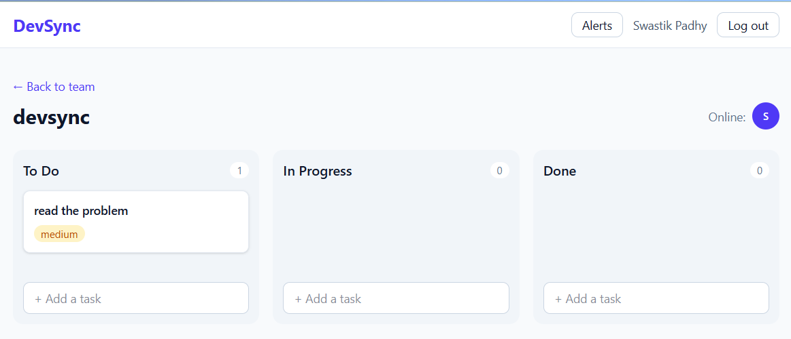
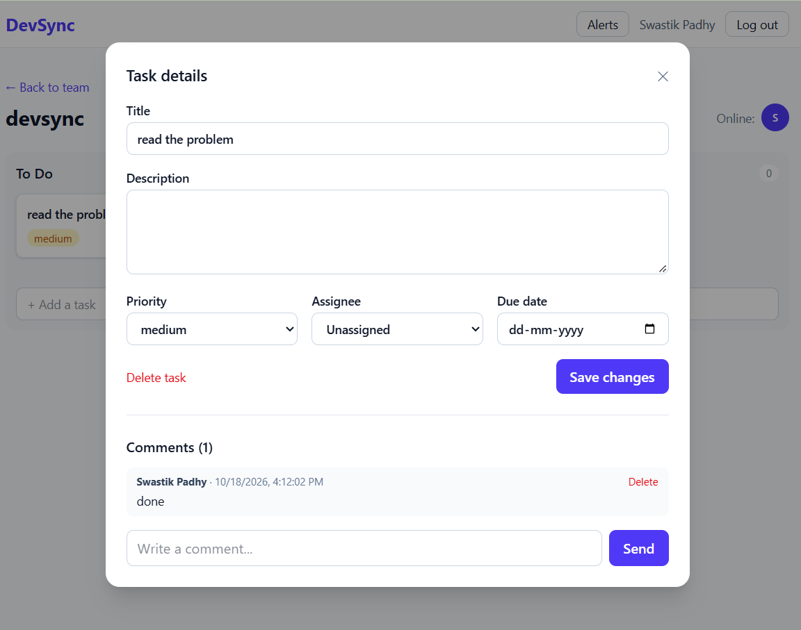
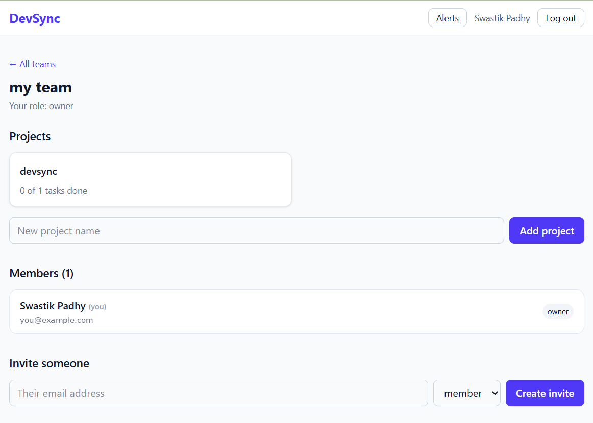
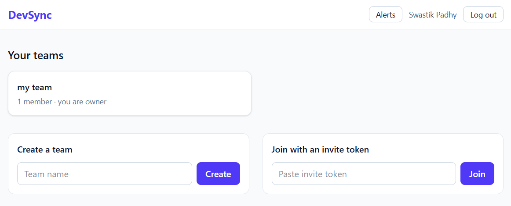
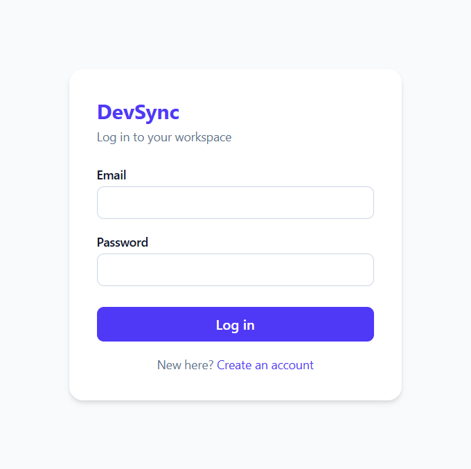
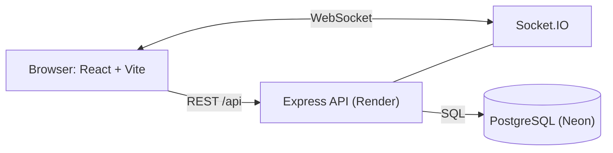

# DevSync

[](https://github.com/swastikpadhy7326/devsync/actions/workflows/ci.yml)

> Real-time task management for developer teams: Kanban boards, roles, comments, notifications and live presence.

**Live demo:** https://devsync-sooty.vercel.app
**API health check:** https://devsync-api-jt06.onrender.com/api/health

> The backend runs on a free instance that sleeps when idle, so the first request can take up to a minute. After that it responds normally.

## Screenshots

**Kanban board** with drag and drop, live presence and notifications



**Task details** with assignee, due date and comments



**Team page** with projects, members, roles and invitations



**Teams dashboard**



**Login**



## Features

- **Authentication:** register and login with bcrypt-hashed passwords, 15-minute JWT access tokens, and rotating refresh tokens that are stored only as hashes.
 Forgotten passwords are reset through a one-time link sent by email.

- **Teams and roles:** owner, admin and member roles, with invitations through one-time tokens.
- **Projects and tasks:** priority, due date, assignee, filters and pagination. Archived projects are read-only.
- **Kanban board:** drag and drop between and within columns. The server keeps card positions consistent inside a database transaction.
- **Comments and an activity log** for every project.
- **Live updates with Socket.IO:** task and comment changes appear instantly for everyone on the board, along with a "who is online" list.
- **Notifications:** saved in the database and pushed live to the right person when they are assigned a task or someone comments on their task.

## Architecture



## Tech stack

| Layer | Choice |
|---|---|
| Frontend | React, Vite, Tailwind CSS, React Router, dnd-kit |
| Backend | Node.js, Express 5 |
| Real time | Socket.IO |
| Database | PostgreSQL (Neon) with plain parameterised SQL |
| Validation | Zod |
| Auth | JWT, bcryptjs, refresh token rotation |
| Hosting | Vercel (frontend), Render (backend), Neon (database) |

## Design decisions

- **Refresh token rotation:** every refresh revokes the old token. Only SHA-256 hashes are stored, so a leaked database cannot be used to log in.
- **Permissions in middleware:** role checks run before the controllers. A person outside a team gets a 404 instead of a 403, so team ids cannot be probed.
- **Consistent card order:** moving a card closes the gap in the old column and opens one in the new column inside a single transaction, so positions always stay 0, 1, 2...
- **Socket security:** the JWT is checked when the socket connects. Joining a project room repeats the same team-membership check as the REST API, and notifications go to a private room per user.
- **No SQL injection:** all values are parameters. The one dynamic query (task updates) takes its column names from a fixed map, never from user input.
- **Dates as plain strings:** `DATE` columns are returned as `YYYY-MM-DD`, which avoids timezone shifts.
- **Notifications never break a request:** a failure while notifying is logged and ignored.

- **Password reset:** the request always gives the same answer, so it cannot be used to find out who has an account. Reset tokens are stored only as hashes, expire after one hour and work once. A reset also signs the person out everywhere by revoking their refresh tokens.

## API overview

| Area | Endpoints |
|---|---|
| Auth | `POST /api/auth/register`, `login`, `refresh`, `logout`, `forgot-password`, `reset-password`, `GET /api/auth/me` |
| Teams | `POST/GET /api/teams`, `GET /api/teams/:id`, `POST /api/teams/:id/invitations`, `PATCH/DELETE /api/teams/:id/members/:userId` |
| Invitations | `POST /api/invitations/accept` |
| Projects | `POST/GET /api/teams/:id/projects`, `GET/PATCH /api/projects/:id`, `GET /api/projects/:id/board` |
| Tasks | `POST/GET /api/projects/:id/tasks`, `GET/PATCH/DELETE /api/tasks/:id`, `PATCH /api/tasks/:id/move` |
| Comments | `POST/GET /api/tasks/:id/comments`, `DELETE /api/comments/:id` |
| Notifications | `GET /api/notifications`, `PATCH /api/notifications/:id/read`, `POST /api/notifications/read-all` |

## Run with Docker

The only prerequisite is [Docker Desktop](https://www.docker.com/products/docker-desktop/).

```bash
git clone https://github.com/swastikpadhy7326/devsync.git
cd devsync
docker compose up --build
```

Then open:

- App: http://localhost:5173
- API health check: http://localhost:5000/api/health

The database starts empty, so register a new account first. Compose runs `server/db/schema.sql` automatically the first time.

### Two servers with Redis

The Compose file starts **two** API servers (ports 5000 and 5001) that share one PostgreSQL database and one Redis. Each API has its own frontend, so you can test real-time features across servers:

- Window A: http://localhost:5173 (talks to API on port 5000)
- Window B: http://localhost:5174 (talks to API on port 5001)

Log in as two different users, open the same project in both windows, and drag a card. The change appears in the other window without a refresh, because the Socket.IO Redis adapter relays events between the servers. The online list and notifications work across servers too.

Redis is optional. Without the `REDIS_URL` environment variable, the server runs as a single instance in memory.

To stop: `docker compose down`. To also wipe the database: `docker compose down -v`.

> The passwords and JWT secret in `docker-compose.yml` are throwaway values for local use only. Never reuse them in production.

### Email invitations

When an owner or admin invites someone, the API saves the invitation and then emails the one-time token through SMTP (Nodemailer). If the email fails, the invitation still exists and the token is still returned to the inviter, so email never blocks the flow.

Email is optional.Without `BREVO_API_KEY` or `SMTP_HOST`, nothing is sent. With Docker Compose, [Mailpit](https://mailpit.axllent.org/) catches every email, so you can read them at http://localhost:8025 without a real email account.

| Variable | Purpose |
|---|---|
| `BREVO_API_KEY` | Sends email through Brevo's HTTPS API (used on Render) |
| `SMTP_HOST` | SMTP server (turns email on) |
| `SMTP_PORT` | SMTP port (default 587) |
| `SMTP_USER`, `SMTP_PASS` | Login, if the server needs one |
| `SMTP_SECURE` | `true` for implicit TLS (port 465) |
| `MAIL_FROM` | Sender, for example `DevSync <no-reply@example.com>` |
| `APP_URL` | App address shown in the email |

> On the live demo, emails go out through the Brevo HTTPS API, because Render's free tier blocks SMTP ports. Set `BREVO_API_KEY` to turn it on. The email contains a one-click link (`/invite/<token>`). The invited person logs in or registers with the same email address and joins the team automatically. The token is also in the email, so it can be pasted into the accept-invitation box as a fallback.


## Run it locally

1. Clone the repo and create a PostgreSQL database (a free Neon project works).
2. Run `server/db/schema.sql` against the database.
3. Create `server/.env`:
   ```
   PORT=5000
   DATABASE_URL=your-postgres-connection-string
   JWT_SECRET=a-long-random-string
   ```
4. Start the backend:
   ```bash
   cd server
   npm install
   npm run dev
   ```
5. Start the frontend in a second terminal:
   ```bash
   cd client
   npm install
   npm run dev
   ```
6. Open http://localhost:5173. Vite proxies `/api` and `/socket.io` to the backend.

### Production environment variables

| Where | Variable | Purpose |
|---|---|---|
| Backend | `DATABASE_URL` | PostgreSQL connection string |
| Backend | `JWT_SECRET` | Secret used to sign access tokens |
| Backend | `CLIENT_ORIGIN` | Frontend address allowed by CORS and Socket.IO |
| Frontend | `VITE_API_URL` | Backend address, with no trailing slash |

## Roadmap

- [x] Authentication, teams, roles and invitations
- [x] Projects, tasks and the Kanban board
- [x] Comments, activity log and notifications
- [x] Real-time updates and presence
- [x] Deployment (Vercel, Render, Neon)
- [x] Automated tests (Jest, Supertest) and GitHub Actions CI
- [x] Docker Compose for one-command local setup
- [x] Redis adapter so Socket.IO can run on several servers
- [x] Email delivery for invitations
- [x] Forgot and reset password by email

## Licensex

MIT
